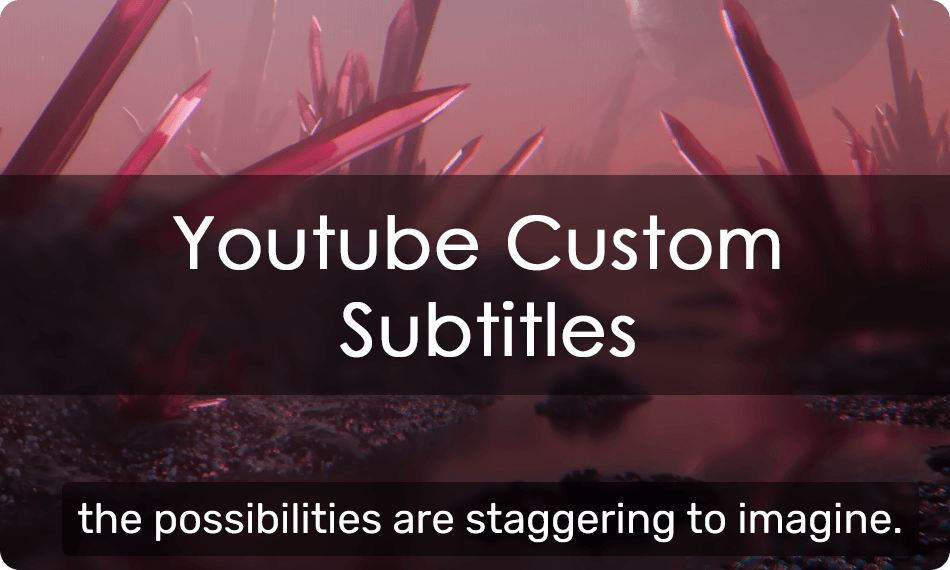

# YouTube Custom Subtitles

A customizable UserCSS for **Stylus** that gives you full control over YouTube subtitle typography, spacing, backgrounds, borders, shadows, and blur effects—all adjustable live from Stylus's built-in settings menu.

## Features

- **Google Fonts & System Fonts:** Type any Google Font name (defaults to `Rubik`) with no quotes or URLs required. Automatically falls back to YouTube's default subtitle font if disabled or unavailable.
- **Typography:** Customize font weight (`200`–`900`), font size (defaults to `42px`; set to `0px` to keep YouTube's responsive default scaling), font color, and independent font blur.
- **Layout & Spacing:** Set individual top, right, bottom, and left padding, switch text alignment (`Left`, `Center`, `Right`), and adjust the distance between subtitle lines—including negative values (defaults to `-12px`) to tighten or overlap lines.
- **Text Shadow:** Optional drop shadow with custom color, opacity, X/Y offset, and blur radius.
- **Background & Box Styling:** Apply background color, opacity, and frosted-glass backdrop blur (`4px` default) to either the **entire subtitle window** or **each subtitle line**.
- **Borders & Corners:** Choose between **Rounded Rectangle** (`8px` default radius) or sharp **Rectangle** corners, plus border width, color, opacity, and soft border glow/blur.

## Requirements

- [Stylus](https://add0n.com/stylus.html) browser extension for [Chrome](https://chromewebstore.google.com/detail/stylus/clngdbkpkpeebahjckkjfobafhncgmne) or [Firefox](https://addons.mozilla.org/en-US/firefox/addon/styl-us/).
  *(Not compatible with the legacy Stylish extension.)*

## Installation

1. Install the **Stylus** extension in Chrome or Firefox.
2. Click the direct install link below to open Stylus's installer automatically:

   

3. Click **Install style** in the Stylus tab that opens.

## Usage

1. Open any YouTube video with captions turned on.
2. Click the **Stylus** icon in your browser toolbar.
3. Click the **gear icon** next to **YouTube Custom Subtitles** to open the settings panel.
4. Adjust any setting to preview changes live on the video.
